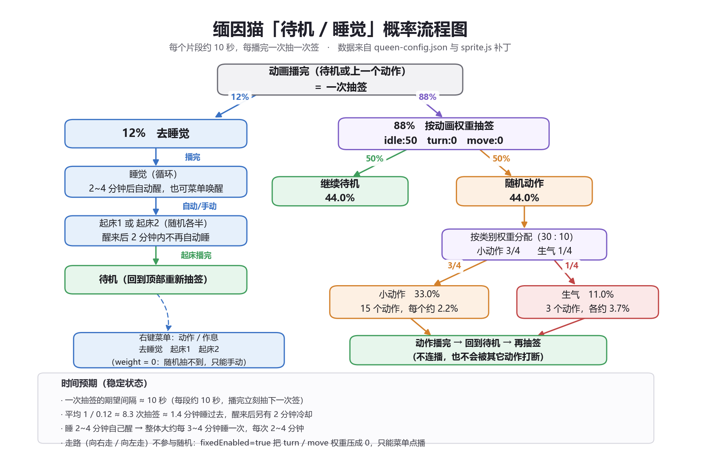

# dsh-mianyin_cat-queen

缅因猫（灰虎斑）桌宠「queen」，为 **dsh-pet** 插件制作的第三方宠物资源包。

- 画布 **960×540（16:9）**、**24fps**、VP9 + alpha（`alpha_mode=1`）
- 动画 **28 段**：待机 1、小动作 15、生气 3、点击回应 2（+4 个双挂）、走路 2（左右各一）、作息 4（去睡觉 / 睡觉 / 起床1 / 起床2）、说话 1
- 全部素材由绿幕视频抠像生成，背景、水印（「豆包 AI 生成」）已清除，毛色做了去绿校正
- 碎碎念表情包 **13 张**（`pet/queen-memes/`，独占目录）+ 专属猫设人设

## 安装

1. 确认 `dsh-pet` 已安装（本包按 **0.3.8 ~ 0.3.10** 的配置结构制作）。
2. 把 `pet/queen-config.json` 和 `pet/queen-animation/` 一起复制到：

   ```
   %USERPROFILE%\.dsh\dsh-pet\pet\
   ```

   最终结构：

   ```
   pet/queen-config.json
   pet/queen-animation/待机.webm
   pet/queen-animation/……（共 28 个 webm）
   pet/queen-memes/傲娇.png
   pet/queen-memes/……（共 13 张表情）
   ```

   > 注意：配置里的动画名**不带扩展名**（写 `"待机"`，不是 `"待机.webm"`）。
   > dsh-pet 的缩略图路由会自己拼 `.webm`，写成带扩展名会 404，整只宠物不可见。

3. 重启 DSH，或在 DSH 运行时执行：

   ```
   curl -X POST http://127.0.0.1:<DSH端口>/dsh-pet-7340/reload
   ```

4. 在宠物设置里把 queen 的「显示位置」选成 **仅桌面** 或 **两者**。

## 碎碎念表情包

碎碎念（whisper）时从表情包里随机抽一张，和图一起显示。本包自带 13 张缅因猫表情：
傲娇 / 无语 / 生气 / 贴贴 / 不想上班 / 在听吗 / 又来 / 马上 / 我先摸会鱼 / 先歇会儿 / 下班 / 达咩 / 打招呼。

实现要点（dsh-pet 的规则，`lib/index.js` 的 `memeDirsFor` / `readMemePool`）：

- 表情放在 `pet/queen-memes/`，这个目录**一旦存在就独占**——不会再去用户目录
  `%USERPROFILE%\.dsh\dsh-pet\memes\` 或包内默认表情里找，所以不会串到别的宠物；
- 配置顶层 `memes` 是「名字 → 描述」映射，**每个名字都要有同名 `.png`**，
  缺图的条目会被静默剔除（描述会写进碎碎念的提示词，帮助模型说出配得上这张图的那句话）；
- `whisperImageEnabled: true` 打开配图；`whisperPrompt` 是本包专属的猫设人设。

想换图：把同名 png 覆盖进 `pet/queen-memes/`（建议 640×640 以内），或改配置里的 `memes` 键名。

## 行为（配合 patches/ 里的客户端补丁）

| 需求 | 实现 |
|---|---|
| 走路只在右键菜单「移动」里点播，不参与随机 | `fixedEnabled: true` + `animationWeights.turn/move = 0` |
| 走路是真的向对应方向移动 | 左右两段素材各自带方向，补丁用 `params.dir` 决定朝向与位移方向 |
| 随机动作播完回待机，不连播 | `patches/patch_queen_v047.py` 的 `[queen-047]` 补丁 |
| 触发的动作必须播完，不被下一个打断 | 同上（`qBusy` 守卫；菜单点播带 `qForce` 才能打断） |
| 待机 ⇄ 睡觉两状态机 | **dsh-pet 0.4.7 原生**：配置 `animations.sleep` = 去睡觉 → 睡觉（循环）→ 起床1/2，`patch_queen_v047.py` 只补「自动入睡 / 自动起床 / 醒来冷却」 |
| 睡觉时点猫只弹提示 | 原生 `sleepRefuseTexts`（配置里写了「小猫睡觉中，请通过『起来』唤醒」） |
| 睡着前点「起床」不生效 | 原生按 `sleeping` 状态白名单拦截；随机链也不会去睡醒段 |
| 菜单点播可打断，随机链不能 | `playOnce` 的 `qForce`（右键菜单置位），宿主事件与随机链不置位 |

## 概率

见 `preview/weights.png`：每段约 10 秒，播完抽一次签 ——
**12% 去睡觉 / 88% 掷骰**，掷骰部分 **待机 50% / 随机动作 50%**，
随机动作再按类别权重 **小动作 30 : 生气 10** 分（实测约 小动作 33% / 生气 11%）。

可用环境无关的方式改：编辑 `pet/queen-config.json` 的 `animationWeights` 与 `animations.categories[].weight`，然后 reload。

## 已知瑕疵（素材限制）

- `伸爪拍屏幕`、`舔屏幕`、`飞机耳` 三段源视频**底部被裁**（猫身一直延伸到画幅最后一行），所以成品贴着画布底边，没有脚爪 —— 这是源素材本身缺内容，不是抠像错误。
- `拍西瓜` 瓜底有零星小白点；`舔屏幕` 边缘略发白（特写镜头的绿边残留）。
- 待机首尾帧视线略有差异（源视频自身节奏），循环接缝有轻微跳变。

## 许可

素材由使用者提供并经本地抠像处理，随包分发前请自行确认素材来源的授权。

## 预览



- `preview/weights.png`：待机 / 睡觉概率流程图
- `preview/qa-sheet.png`：28 段成品的抠像质量总览（白底，每段早/中/晚三帧）
- `preview/align-sheet.png`：各段首帧落位与尺度对齐总览（与待机一致）
